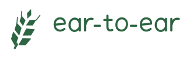
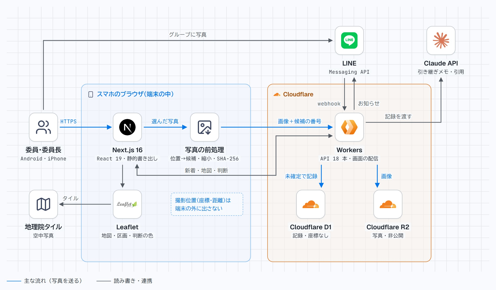

# ear-to-ear — 穂から穂へ、写真と判断をつなぐ

> ear ＝ 麦の穂。ear to ear ＝ 満面の笑み／穂から穂へ、委員から委員へ。

<p align="center">
  <br>
  <sub>穂から穂へ、写真と判断をつなぐ</sub>
</p>

<p align="center">
  <b>▶ デモ動画（3 分）</b>: <!-- TODO(提出時): 動画の URL --> ／
  <b>デモのサイト</b>: <a href="https://harvest-share-dev.ryokou1119.workers.dev/">harvest-share-dev.ryokou1119.workers.dev</a>（ログイン不要。見るだけ）<br>
  <sub>📱 スマホのブラウザ向けに最適化した Web アプリです。スマホで開くか、PC では窓の幅を狭めてご覧ください</sub>
</p>

Built with Claude: Japan 2026（2026-11-02 12:00 〜 11-08 20:00 JST）の期間中に、2 人のチームがゼロから作りました。

## 目次
- [プロダクト名](#プロダクト名) ／ [コンセプト](#コンセプト) ／ [背景と課題](#背景と課題) ／ [対象ユーザ](#対象ユーザ) ／ [利用の流れ](#利用の流れ) ／ [推しポイント](#推しポイント)
- [できること（画面ごと）](#できること画面ごと) ／ [審査員の方へ: デモの見方](#審査員の方へ-デモの見方)
- [Claude の使い方](#claude-の使い方) ／ [開発体制](#開発体制) ／ [開発における工夫した点](#開発における工夫した点)
- [仕組み（アーキテクチャ）](#仕組みアーキテクチャ) ／ [開発技術](#開発技術) ／ [テストと品質](#テストと品質)
- [確かめたこと・まだのこと](#確かめたことまだのこと) ／ [制約](#制約いま分かっていること) ／ [手元で動かす](#手元で動かす) ／ [文書の一覧](#文書の一覧) ／ [ライセンス](#ライセンス)

## プロダクト名
**ear-to-ear**（イヤー・トゥ・イヤー）— 穂から穂へ、写真と判断をつなぐ

## コンセプト
**小麦の収穫委員のための、写真と判断の共有サイト。**
委員が写真を選んで送るだけで、どの畑かの候補と撮影日が付き、ほかの委員の画面にすぐ届きます。
畑の番号が決まらなくても「未確定」として先に共有し、管理者（委員長）が確定・訂正します。
「刈れるか」の判断とその理由も同じ地図に残り、Claude が引用（Citations）で一文ごとに根拠を示した引き継ぎメモを書きます。

中心にしているのは 2 つです。
1. **写真を見つける**: どの写真がどの畑の、いつの写真かがすぐ分かる
2. **判断を根拠つきでたどれる**: 何を見て「刈れる」と決めたかが、写真と一緒に翌年まで残る

## 背景と課題
北海道更別村では、小麦を地区ごとに共同で収穫します。
コンバインを共同で使うので、どの畑をどの順番で刈るかを、委員会が毎年決めます。
雨に濡れると小麦の品質が下がるので、刈る順番には全員の納得が要ります。

順番を決めるために、委員はドローンで畑を上から撮り、LINE で送り合います。
ところが、いまのやり方には 3 つの困りごとがあります（委員長である作者の父への聞き取りから）。

| 困りごと | いまの状態 | 委員長の言葉・事実 |
|---|---|---|
| **どの写真がどの畑か分からない** | 写真と畑の番号が別々に LINE に流れる | 「時間より、見づらい」 |
| **一人の作業を待たないと共有されない** | 一人が写真を受け取り、番号を付けてから載せている | — |
| **判断の理由が翌年に残らない** | その年に何を見て「刈れる」と決めたかは、次の年の委員には残らない | 判断の決め手は「穂の色」と「畑に占める黄色い穂の割合」 |

ear-to-ear は、委員の手間を LINE で送るのと同じに保ったまま（増やさずに）、一人の作業を待たずに共有できるようにします。
全体の作業時間が減るかは測っていないので、主張しません。

## 対象ユーザ
- **収穫委員**（毎年替わる）
  - 撮った写真を、手間を増やさずに全員に届けたい
  - 目的の畑・日付の写真をすぐ見つけたい
- **委員長（管理者）**
  - 畑の番号を確定・訂正したい
  - 判断を記録し、刈る順番を決めて全員に伝えたい
- **翌年の委員**
  - 去年はいつ、何を見て刈ったのかを知りたい

同じように「現場の写真を集めて、みんなで判断し、翌年に引き継ぐ」共同作業（防除・草刈り・見回りなど）にも広げられる形にしています。

## 利用の流れ

### 委員: 写真を送る
1. スマホのブラウザで `/upload` を開き、写真を選ぶ（複数可）
2. スマホの中で、写真の撮影位置から畑の番号の候補（近い順に 3 つまで）と撮影日が付く。撮影位置は候補を出したら捨て、サーバーには送らない
3. 「送る」を押す。合言葉は、最初に送ったときに一度だけ聞かれる（30 日有効）
4. ほかの委員の新着（`/recent`）に「未確定（推定 A-06）」で届く

いつもの LINE のグループに写真を送るだけでも、サーバーが受け取って新着に「未確定」で入れます。

### 委員長: 確定し、判断を残し、順番を決める
1. 新着で「確定・変更」を押し、畑の番号を確定・訂正する（誰がいつ直したかが履歴に残る）
2. 地図（`/`）で畑を選び、写真を見比べる（同じ日の別の畑・この畑の前の日・昨年の同じ頃）
3. 「収穫可能と判断」「収穫済と判断」を押し、理由（穂の色・黄色い穂の割合・農協の判定で中止）と根拠の写真を付けて記録する。委員の LINE グループに、サムネイル付きで 1 通届く
4. 刈る順番（`/order`）で、記録からの下書きを並べ替えて確定する。確定した順を地図 1 枚の絵にし、LINE に送る

### 翌年の委員: 引き継ぎを読む
1. シーズンの終わりに、委員長が畑ごとに引き継ぎメモを作る（Claude が 1 年分の写真と判断から書く）
2. メモの一文ごとに付いた印を押すと、元の記録（写真・判断）に戻れる
3. 翌年、昨年に判断した頃になると、地図に「昨年の引き継ぎ（2025年）あり」が出る

## 推しポイント
- **送るだけで、畑の番号の候補と撮影日が付く**
  - ドローン（DJI）の写真は、位置を EXIF ではなく XMP に持つ。両方を読み、機種による綴りの違い（`GpsLongtitude`）にも対応した
  - 番号が決まらなくても「未確定」で先に共有する。共有の完了と番号の確定を分けたので、一人の作業を待たない
- **撮影位置は端末の外に一切出さない**
  - 座標だけでなく、候補の畑までの距離も送らない（距離 3 つと畑の位置から、撮影位置を約 0.3 m で逆算できてしまうため）
  - 送る画像はスマホの中で縮小・再エンコードし、位置・日時などのメタデータ（APP1〜15）を全部消す。サーバーでも無いことを確かめてから保存する
- **判断が理由と根拠の写真つきで残り、取り消しても消えない**
  - 理由の選択肢には、農協の判定で中止（水分超過・砕けなどの傷）も入れた
  - 水分の値や「刈れるか」を、AI に推定させない
- **Claude の引き継ぎメモは、一文ごとに元の記録を指す**
  - Claude API の引用（Citations）で、記録 1 件を 1 つの要素として渡す。引用は渡した記録のどれかを指すことが API で保証される
  - 記録に無いことは書かせない。根拠の無い文は灰色の「根拠なし」で分けて見せる
- **いつもの LINE とつながる**
  - LINE から写真を受け取る／判断のお知らせが届く／刈る順番の地図がサムネイルで届く
- **人はテストだけを書き、実装は人のいない Claude が書いた**
  - 組み込みの道具を外し、自作の MCP の道具だけを渡した「檻」の中で動かした（[Claude の使い方](#claude-の使い方)）

## できること（画面ごと）
<p align="center">
  <br>
  <sub>地図の画面（手元で動かしたもの）。空中写真は地理院タイル、区画の番号・名前は架空</sub>
</p>

| 場面 | 画面 | 中身 |
|---|---|---|
| 送る | `/upload` | 写真を選ぶと、写真ごとにプレビュー・撮影日（不明なら「日付不明」）・畑の番号の候補（3 つまで）が出る。番号は任意で選べる。**撮影位置は端末の中で使い終えたら捨て**、画像のメタデータは全部消してから送る。同じ写真をもう一度送ると「送り済み（同じ写真）」になる |
| LINE から送る | — | 委員の LINE グループに送った写真も、サーバーが受け取って新着に「未確定」（候補なし・撮影日なし）で入れる。受け取ったら 1 回だけ返事をする。大きすぎる・JPEG でない写真は入れず、Web の「写真を送る」を案内する |
| 届く・確定する | `/recent` | 新着の一覧。「未確定（推定 A-06）」「確定 A-06」。「未確定だけ見る」で絞れる。管理者の端末にだけ「確定・変更」が出て、候補を「推定」として先に、残りを地区ごとに並べる。直した履歴が残る |
| 地図 | `/` | 空中写真の上に畑の区画。判断の色（黄緑は「収穫可能」だけ、収穫済は濃い色、未判断は塗らない）、地区の目安の畑（金の輪郭）、刈る順番の丸。畑を押すと、下の板に最新の写真と判断 |
| 詳細・判断を残す | `/fields/[id]` | 主役の写真、今の判断、「収穫可能と判断」「収穫済と判断」の 2 ボタン（理由・メモ・根拠の写真を付けて記録。記録する前に LINE に届く内容を確かめられる）、写真の流れ、昨年の同じ頃、判断の履歴（取り消しも残る） |
| 見比べる | `/fields/[id]#compare` | 「同じ日に撮った別の畑と」（上下 2 つの窓。相手の既定は地区の目安の畑）と「この畑の前の日と」（重ねて境目を動かす）。判断の操作は置かない |
| 刈る順番 | `/order` | 記録から下書きを作る（順位を付けるのは今年「収穫可能」と判断した畑だけ）。持ち手で並べ替え、委員長が 2 段階で確定。確定した順を地図 1 枚の絵にして共有の URL を作り、LINE に貼るとサムネイルで届く |
| 引き継ぎメモ | `/fields/[id]` | 委員長だけに出る。1 年分の写真と判断から、Claude が次の年の委員へのメモを書く。**一文ごとに元の記録を指し**、印を押すとその記録に戻れる。根拠の無い文は「根拠なし」 |
| 昨年の引き継ぎ | `/`・`/fields/[id]` | 昨年に判断した日の前後だけ、昨年のメモを出す。「あと n 日」のような数字は言わない（デモの昨年のメモは手で書いた架空の例） |
| LINE のお知らせ | — | 判断を残した・取り消したときに、委員の LINE グループに 1 通（番号・状態・理由・日時・URL。根拠の写真の 1 枚目がサムネイルになる）。メモと撮影位置は送らない。通知が失敗しても記録は成功する |

下の帯で「地図／比較／順番」を切り替えます。選んだ畑は 3 つの画面で引き継がれます（`/#A-03`・`/fields/A-03#compare`・`/order#A-03`）。
屋外・手袋での操作を想定し、文字は大きめ、ボタンは押しやすくしています。

## 審査員の方へ: デモの見方
- デモのサイト（https://harvest-share-dev.ryokou1119.workers.dev/ ）は**ログイン不要**で、見るだけです（合言葉は配っていないので、送る・判断する操作はできません）
- **スマホで開いてください**。スマホのブラウザ向けに最適化した Web アプリです（PC では窓の幅を狭めると、スマホに近い見え方になります）
- 見られるもの: 地図、畑の詳細と見比べる画面、判断の履歴、刈る順番
- **昨年の引き継ぎ**は、URL の末尾に `?today=2026-07-20` を付けると出ます（今日の日付を昨年の判断の頃に差し替えて見るため。例: https://harvest-share-dev.ryokou1119.workers.dev/?today=2026-07-20 ）
- デモの畑の番号・名前・判断の記録・刈る順番は**すべて架空**です（[安全とプライバシー](#安全とプライバシー)）

## Claude の使い方
詳しい記録は [docs/claude-usage.md](docs/claude-usage.md)。行ごとに PR・Issue・記録へのリンクが付いています。

### 作品の中の Claude（引き継ぎメモ）
- **何に使うか**: 畑ごとの 1 年分の写真と判断の記録から、翌年の委員が読める短い引き継ぎメモを書く
- **引用（Citations）で根拠を付ける**: 記録 1 件をカスタムコンテンツの 1 要素として渡し、返事の引用の要素の番号から元の記録に戻す（決定 K17）
  - 渡した記録の範囲の外を指す引用は捨てる。引用の無い文は「根拠なし」として分けて見せる
  - 返事の形が違う・途中で切れた・拒否されたときは保存せず、理由と Claude の状態コードを返す
- **呼び方**: SDK を入れず、Worker から `fetch` で Claude API を直接呼ぶ（依存を増やさない）。モデルは `claude-sonnet-5-5`（`src/config.ts`）
- **使いすぎ・事故を防ぐ**: 呼べるのは管理者だけ。1 日 50 回まで（環境全体）。`max_tokens` 1024、30 秒で打ち切り、自動の再試行なし。環境変数 `CLAUDE_ENABLED=false` で全部止められる
- **言わせないこと**: 水分の値や「刈れるか」は Claude に言わせない。実在の農家のデータは Claude API にも送らない
- **指示文の試作**: API のキーが入る前に、claude.ai のアーティファクトを「疑似 API」の試作台にした。記録に指示を混ぜた見本で崩れる所を見つけ、3 回の書き換えと 5 回の試しで、根拠の無い文を 0/3 にした（[#119](https://github.com/akutodazo/ear-to-ear/pull/119)）
- 開発用の環境（dev）で、本物の Claude を通して引き継ぎメモが作れることを確かめた（手順は [docs/dev/l6-live.md](docs/dev/l6-live.md)）

### 作るときの Claude（開発の中心）
6 日間でいちばん足りないのは、人が確かめる時間でした。
そこで「**人はテストを書いて読む、実装は人のいない Claude が書く**」形を作りました。

1. **檻リレー（無人の実装）**
   - 人がテスト（RED）を書いて凍結し、実装（GREEN）だけを人のいない Claude に任せる
   - その Claude からは組み込みの道具をすべて外し、自作の MCP の道具（ファイルを読む・書く、テストを流す、報告する など）だけを渡した。シェルは無く、書ける場所は許可リストだけ（[docs/dev/cage.md](docs/dev/cage.md)）
   - LLM を呼ばない Node の進行役が、パケット（1 本の作業）を 1 本ずつ順に回す（[docs/dev/harness-v0.6-relay.md](docs/dev/harness-v0.6-relay.md)）
   - **11 月 4 日の 1 日で、サーバーの機能 10 本（T22〜T31）をこの形で実装し、10 本とも検査 C1〜C5 に合格した**。1 本あたり 8〜22 手。T23〜T31 の 9 本の費用は合計 $5.09（API 換算）
   - 檻を直接たたく攻撃 8 種類は、すべて拒否された（[#14](https://github.com/akutodazo/ear-to-ear/issues/14)）
2. **攻撃役（テストを凍結する前に破らせる）**
   - 仕様を知らない別の Claude（Sonnet、1 回 $0.07〜0.27）に「ズルで全件通して」と頼み、見つかった抜け道を塞いでから凍結した（[docs/dev/test-attack.md](docs/dev/test-attack.md)）
   - 例: 22 件のテストを全部通す手抜きが書けたので、テストを足して 47 件にした（[#24](https://github.com/akutodazo/ear-to-ear/pull/24)）。ほかにも「記録を読まず決まった 3 件を返す」「先頭の 1 行だけ検査する」などを塞いだ
3. **わざと壊して、テストが落ちるかを確かめる**
   - 無人の実装を受け取る前に、実装をわざと壊してテストが落ちるかを確かめた（例: T27 18/18、T31 15/15）。落ちなかった所からテストの穴を 5 つ見つけて足した
4. **止まる決まり**
   - 「テストが誤りに見えても直さない。仕様に無いことは推測で書かず、止まって報告する」を決まりにした（AGENTS.md §5）
   - 実際に、無人の Claude が作業の一覧を読み切れなかったとき、推測で書かずに何も変えずに止まり、直し方を勧めた（[#112](https://github.com/akutodazo/ear-to-ear/pull/112)）
5. **書いた会話を見ていない別のセッションがレビューする**
   - 撮影位置・実データ・秘密に関わる PR は、書いた会話を見ていない別の Claude Code のセッション（Opus）がレビューする。渡すのは PR の番号だけ
   - 認証の部品では、攻撃役で見つからなかった期限の上限の抜けを見つけた（[#24](https://github.com/akutodazo/ear-to-ear/pull/24)）
   - デプロイの仕組みでは「止める」を 2 回出し、2 回とも設計を変えた（[#122](https://github.com/akutodazo/ear-to-ear/pull/122)・[#125](https://github.com/akutodazo/ear-to-ear/pull/125)）
   - 別の会社のモデル（Codex）の点検も、必要なときだけ使った

### モデルと機能の使い分け
| 役 | 使ったもの | 理由 |
|---|---|---|
| アイデア出し・荒探し・詰まったときの相談 | Claude Fable（別のセッション） | 発想を広げる用途。作業中のセッションのモデルは変えない |
| 設計・テスト（RED）・レビュー | Claude Code（Opus、デスクトップアプリ）と人の対話 | 合格条件を人が読んで決める段階。決まりを読み違えないモデルを使う |
| 無人の実装（GREEN） | Claude Code CLI（`claude -p`、Opus）＋自作の MCP の道具 | 1 本 $0.29〜0.68。テストを凍結し、変えてよいファイルを絞る |
| 攻撃役 | Claude Sonnet（`claude -p`、檻の中） | 安く何度も試す（1 回 $0.07〜0.27） |
| 指示文の試作 | claude.ai のアーティファクト、Claude in Chrome | キーを待たずに、架空の記録で指示文の出来を人が見る |
| 作品の中 | Claude API（引用、`claude-sonnet-5-5`） | 根拠が必ず渡した記録を指す |
| 無人の安全 | `.claude/settings.json` の deny（秘密の読み取り・デプロイ・main への push） | 人がいない間に秘密・公開・main を触らせない |

## 開発体制

### 役割分担
| メンバー | 主な担当 |
|---|---|
| Ryokou Tanaka（[@akutodazo](https://github.com/akutodazo)） | 企画と委員長（父）への聞き取り、仕様と合格条件、写真を送る・新着・畑の画面、判断と引き継ぎメモの画面側、画面の再設計（地図・見比べる・刈る順番・来年の引き継ぎ）、安全検査、Android の実機での確認 |
| Satoru Takahashi（[@satorutkhs](https://github.com/satorutkhs)） | 無人で実装させる仕組み（MCP の檻・檻リレー・攻撃役の手順）、サーバーの API、引き継ぎメモのサーバー側（Claude API）、デプロイ（GitHub Actions・Cloudflare）、LINE（お知らせ・写真の受け取り・共有の URL）、iPhone の Safari での確認、画面の作り直し |

どちらも、コードは Claude に書かせ、人はテスト・仕様・レビュー・実機の確認を受け持ちました。
担当はフォルダで分け、同じファイルを 2 人が書かないようにしました（ブラウザ側／サーバー側／両方の承認が要る共有のファイル。AGENTS.md §2）。

### 開発の進め方
- **合格条件を先に書く → テスト → 実装**。テスト（RED）と実装（GREEN）は別のコミットにした
- **1 つの PR に 1 つの関心事**。PR の本文に、影響範囲・使ったライブラリ・同時に更新した文書・弱点候補 3〜5 個・検証ログを書く
- 期間中にマージした PR は 144 本（11-08 時点）。main に直接 push しない（GitHub の Ruleset で、PR 必須・CI 必須・削除と force push の禁止）
- 決めたことは、背景と理由と一緒に [docs/decisions.md](docs/decisions.md) に残した（K1〜K17 と、期間中の決定）。確かめた事実（Known）と未確定（Unknown）は [docs/spec.md](docs/spec.md) の §12 で分けた
- 合格条件ごとに、どのテスト・PR・確かめ方で満たしたかを一本でたどれる表にした（[docs/spec.md](docs/spec.md) の §9）
- 父への聞き取りで前提が崩れたときは、機能ごとやめた（水分の手入力・紙の読み取りの段。水分は農協がトラックの荷ごとに測るので、畑ごとの値が残らない。決定 K16）

## 開発における工夫した点

### 全般
- 仕様・決定・公開範囲を文書にし、会話を知らない Claude でも同じ判断に行き着けるようにした（[docs/spec.md](docs/spec.md)・[docs/decisions.md](docs/decisions.md)・[docs/privacy.md](docs/privacy.md)）
- Claude Code と Codex の両方が読む共通の決まりを `AGENTS.md` に置き、`CLAUDE.md` からはそれを読み込む形にした
- 仮説に期限と「崩れたときの代替」を付けて台帳にした（[docs/hypotheses.md](docs/hypotheses.md)）
- 実機・二端末・試用の記録を残した（[docs/verification/](docs/verification/)）

### ブラウザ側（画面）
- **層を分けた**: 型／Service（純粋関数。ブラウザ API・React・fetch に依存しない）／Repository（契約は Promise、fetch は引数で注入）／Presenter（`use-*` のフック）／UI 部品（props だけ）／page（配線だけ）。テストの主戦場は Service
- **写真の前処理はブラウザで行う**（決定 K3）。Cloudflare Workers の無料枠は 1 リクエストの CPU が 10ms なので、12MB の写真はサーバーで扱えない。ブラウザで撮影位置と日時を読み、候補を計算し、長辺 1600px に縮小して JPEG に作り直し、元ファイルの SHA-256 を取る。結果として、撮影位置が端末の外に出ない
- Chrome の canvas の再エンコードは色の情報（APP2）を必ず付けるので、送る前に APP1〜15 を取り除き、残っていないことを確かめてから送る
- 地図は Leaflet と地理院タイルの空中写真。刈る順番の地図 1 枚の絵は、canvas に地理院タイルを描いて作る
- 静的書き出し（`output: 'export'`）なので、畑の詳細のページは全圃場ぶんを `generateStaticParams` で作る

### サーバー側（Worker）
- **ハンドラは薄く、判定は Service に置く**。Worker では CPU 10ms に収まる処理だけ（JPEG はセグメントの見出しをたどるだけで、デコード・縮小はしない）
- 受け取る写真の検査: Cookie の検証 → APP1〜15 が無いこと → ハッシュで二重を確認（409）→ R2 に保存 → D1 に「未確定」で記録
  - 保存の途中で失敗したら R2 の画像を消し、孤立した画像を残さない
  - 送る情報（meta）は 5 項目の許可リストだけ。**距離・座標の項目があれば 422 で拒否する**
- 合言葉は委員用と管理者用の 2 つ。照合は `crypto.subtle.timingSafeEqual`。Cookie は HMAC-SHA256 で署名（HttpOnly・Secure・SameSite=Lax、30 日）
- 合言葉の失敗は、IP のハッシュごとに 10 分に 5 回まで。生の IP は保存しない
- LINE は署名を検証し、本文は 64KB まで。写真の受け取りは 1 日 30 枚、1 回の webhook で 10 枚・20 秒まで。お知らせは無料枠（月 200 通）の手前で止まる
- データベースの変更（migration）は SQL のテストで確かめてから流す（`node:sqlite`）

### 安全とプライバシー
- **撮影位置（座標）は端末の外に出さない**（決定 K6）。サーバーに届くのは候補の番号だけで、D1・R2・通信のどこにも座標と距離は無い（[docs/privacy.md](docs/privacy.md)）
- 送る画像は端末で作り直し、位置・日時などのメタデータ（APP1〜15）を全部消す。サーバーでも無いことを確かめてから保存する。LINE から受け取った写真も、サーバーで画像の中身だけを残してから保存する
- 公開リポジトリには、実写真・実在の畑の座標・合言葉・API キーを入れない
  - 安全検査 `npm run check:safety` を毎回の CI で流す。コミットされた全ファイルについて、画像のメタデータ・CSV・秘密らしい文字列・架空データの座標の範囲を確かめる
  - 履歴全体の検査（`node scripts/check-history.mjs`）も流した（11-06 に 211 コミットで合格）
  - GitHub の Secret scanning と Push protection をオンにし、コミットのメールは noreply にした
- 地図の区画の番号・名前・判断の記録・刈る順番は架空。区画の形は、作者の家とは無関係の公開の農地の空中写真に写る畑の境目からなぞった
- デモのサイトと動画に出る畑の写真は、作者の家族が撮った本物の写真。アプリの「送る」から入れたので、位置と日時のメタデータは消えている。番号は架空の区画に付け直した。リポジトリには入れていない
- デプロイは GitHub Actions。main へのマージで dev に、demo は人が画面で押して承認したときだけ。Cloudflare のトークンは GitHub の Environment の秘密にだけ置き、`pull_request` では動かさない（[docs/dev/deploy-actions.md](docs/dev/deploy-actions.md)）

### デザイン
- 「最初の視線を畑に向ける」（画面の再設計のときのインタビューでの合意）。一覧に出すのは番号・日付・写真・判断の色だけにし、数字は控えめにした
- 文字だけで状態を説明している所には、線のアイコンと状態の印を添えた（文字は消さない）
- 期間中に外部の方から画面のフィードバックを受け、詳細と比較の切り替え、刈る順番の画面を作り直した
- 見た目の決まりは [docs/design/](docs/design/)

## 仕組み（アーキテクチャ）
動いているときの構成です。撮影位置（座標・距離）はスマホの中で使い終えて捨て、位置の情報としてはサーバーに畑の番号の候補だけを送ります。作るときの道具と検査の流れは [テストと品質](#テストと品質) の図にあります。

<picture>
  <source media="(prefers-color-scheme: dark)" srcset="public/demo/readme-architecture-dark.jpg">
  
</picture>

<details>
<summary>図を文字で読む</summary>

```text
[スマホのブラウザ]（HTTPS）
  写真を選ぶ
   → XMP/EXIF から撮影位置・日時を読む（位置は送らない）
   → 圃場の一覧から候補を計算（近い順に最大 3。距離は画面に出すだけ）
   → 長辺 1600px に縮小・JPEG に作り直す（メタデータは全部消える）
   → 元ファイルの SHA-256
   → POST /api/uploads（縮小した画像＋{撮影日, 候補の番号, ハッシュ}）
[Cloudflare Workers]
   → Cookie の検証 → APP1〜15 が無いか → 二重か（409）
   → R2 に画像、D1 に「未確定」で記録
[LINE]
   → webhook で写真を受け取る（未確定で新着へ）／判断のお知らせ／共有の URL のサムネイル（OGP）
[Claude API]
   → 引き継ぎメモ（記録 1 件＝1 要素、引用で元の記録に戻す）
```
</details>

- **データ**（D1、`migrations/`）: 写真（`uploaded_photos`）、番号の確定・訂正の履歴（`photo_assignments`）、判断（`field_status_events`、取り消しは消さずに印を付ける）、回数の上限（`usage_counters`）、引き継ぎメモ（`handover_notes`）、設定（`settings`）、刈る順番の共有（`order_shares`、60 日で期限切れ）。どれも座標・距離を持たない
- **画像**（R2）: 非公開のまま、Worker の `GET /api/photo-files/:id` で配信する
- **畑の一覧**: 架空の 12 圃場（A-01〜A-12、北・中・南の 3 地区）を静的な JSON で持つ（`src/data/`）
- **API**: 18 本（合言葉・送る・新着・確定・判断・取り消し・判断の履歴・地図のまとめ・引き継ぎメモ・LINE・共有）と、死活確認の `/api/health`。表は `worker/routes.ts`。一覧と、成功・失敗の状態コードは [docs/spec.md](docs/spec.md) の §6
- **環境**: 手元（`wrangler dev`）／dev（実機の確認、HTTPS。**審査員に公開しているデモのサイトもこの dev**）／demo（審査員用に D1・R2・秘密を dev と分けた環境。設定と承認の流れまで用意し、11-08 時点ではまだ出していない）

## 開発技術
どの技術がどこで動くかは、2 枚の図にロゴで示しています（動いているときは [仕組み](#仕組みアーキテクチャ)、作って確かめるときは [テストと品質](#テストと品質)）。

### 利用したプログラミング言語
- TypeScript
- SQL（SQLite / Cloudflare D1）

### 利用したフレームワーク・ライブラリ
| 部分 | 使ったもの |
|---|---|
| 画面 | Next.js 16（App Router、静的書き出し）、React 19、Leaflet |
| サーバー | Cloudflare Workers（フレームワークなし。ルーターも自作） |
| テスト | Vitest |
| 型・lint | TypeScript 5、ESLint 9（`eslint-config-next`） |
| 開発用 | Wrangler 4、`@cloudflare/workers-types` |

依存は意図して少なくしています（実行時の依存は `next`・`react`・`react-dom`・`leaflet` の 4 つ）。Claude API と LINE Messaging API も SDK を使わず `fetch` で呼びます。

### 利用したサービス・API
- Claude API（`claude-sonnet-5-5`、引用 Citations）
- Cloudflare Workers・D1（記録）・R2（写真）
- LINE Messaging API（お知らせ・写真の受け取り）
- 地理院タイル（空中写真。出典表記「地理院タイル」）
- GitHub（Ruleset・Secret scanning・Push protection）、GitHub Actions（CI と、dev・demo へのデプロイ）

### その他開発に使用したツール
- Claude Code（デスクトップアプリ、CLI の `claude -p`、Remote Control でスマホから）
- 自作の MCP サーバー（無人の Claude に渡す道具の「檻」）
- Claude Fable（アイデア出し・荒探し・詰まったときの相談）
- claude.ai のアーティファクト（指示文の試作台）、Claude in Chrome
- Codex（別の会社のモデルの目が要るときの点検）
- stack-diagram（README の 2 枚の構成図。重なり・はみ出し・切れた線は、描いた画像を自作の点検で確かめた）
- Node.js 24

## テストと品質
作って確かめる流れです。人がテストを書いて凍結し、実装は「檻」の中の Claude が書き、PR ごとに CI が 5 段の検査を流します。

<picture>
  <source media="(prefers-color-scheme: dark)" srcset="public/demo/readme-pipeline-dark.jpg">
  
</picture>

<sub>2 枚の構成図は [stack-diagram](https://github.com/caru-ini/stack-diagram)（MIT License）で描きました（リポジトリに入れたのは画像だけ）。ロゴは各社の商標です。</sub>

- `npm run check` で、安全検査 → lint → 型 → テスト → build を順に流す。CI（GitHub Actions）でも毎回同じものを流し、通らないとマージできない
- テストは 2,779 件・132 ファイル（11-08 時点）。Service は純粋関数なので、ブラウザや fetch なしでテストできる
- 例外を期待するテストでは、何を期待するか（例外の種類か文言）を必ず書く
- `any`・`@ts-ignore`・`eslint-disable` は使わない決まり
- メタデータ付きの写真が要るテストは、テストの中でバイト列を組み立てる。合成写真（8 種類）は依存なしの JPEG の書き出しで作り、`/private/fixtures/`（コミットしない）に出す

## 確かめたこと・まだのこと
合格条件と、それぞれをどう確かめたかは [docs/spec.md](docs/spec.md) の §9、実機の記録は [docs/verification/](docs/verification/)。

- **済**
  - 二端末（Android と PC）で、一方が送った写真が他方の新着に未確定で届き、確定が両方に見える
  - 送る中身に撮影位置（座標・距離）が無い
  - Android の Chrome と iPhone の Safari で、写真を選ぶと候補と撮影日が出る（DJI の XMP の位置）
- **dev で動いた**
  - 本物の Claude での引き継ぎメモ
  - iPhone の Safari と LINE で、刈る順番の共有の URL のサムネイル
  - iOS シミュレータの Safari で、送る・新着・確定・番号の付け替え
- **まだ**
  - 委員長（父）による試用
  - 実写真の撮影位置で、候補 3 つに正しい畑が入る割合（測るまで数字を書かない）
  - iPhone の実機での送る・確定

## 制約（いま分かっていること）
- 小麦の水分は推定しない。水分は収穫後に農協でトラックの荷ごとに測られるので、その判定は「判断の理由」として残す
- 画像の見比べは判断の補助で、自動で「刈れる」とは言わない
- **Android の Chrome は、スマホのカメラで撮った写真の撮影位置を消して渡す**。この場合は候補が出ず、「未確定」で送って管理者が番号を確定する（ドローンの写真の位置は残る）
- 二重送信の判定は元ファイルのハッシュなので、保存し直した写真や LINE で再圧縮された写真は別の写真として扱われる
- 刈る順番の並べ替えは、いまは端末の中だけに保存する（共有は、確定した順の絵を LINE に送る形）
- 新着は自動では更新しない（「更新」ボタンで読み直す）

## 手元で動かす
動作環境: Node.js 24（CI と同じ版）。画面はスマホのブラウザ（Android の Chrome・iPhone の Safari）と PC のブラウザで使います。

```bash
npm ci
npm run check   # 安全検査 → lint → 型 → テスト → build
```

画面と API（Cloudflare Workers・D1・R2）を手元で動かす（Cloudflare へのログインは不要）:
1. `.dev.vars`（Git に入らない）を作り、`MEMBER_PASSPHRASE`（委員の合言葉）・`ADMIN_PASSPHRASE`（委員長の合言葉）・`SESSION_SECRET`（Cookie の署名の鍵）を `名前=値` の形で書く（手元の試し用の値。2 つの合言葉は別の値にする）。Claude と LINE は任意で、無ければ使わない（`CLAUDE_API_KEY`・`LINE_CHANNEL_ACCESS_TOKEN`・`LINE_CHANNEL_SECRET`）。名前の一覧は [worker/env.ts](worker/env.ts)
2. `npm run build`
3. `npx wrangler d1 migrations apply DB --local`
4. `npx wrangler dev` → `http://localhost:8787`

Claude と LINE を手元で使うときの設定は [docs/dev/l6-live.md](docs/dev/l6-live.md)・[docs/dev/line.md](docs/dev/line.md)。

## 文書の一覧
| 文書 | 中身 |
|---|---|
| [docs/spec.md](docs/spec.md) | 仕様（流れ・データ・API・画面・合格条件・Known／Unknown） |
| [docs/decisions.md](docs/decisions.md) | 決定（K1〜K17 と期間中の決定。背景と理由つき） |
| [docs/privacy.md](docs/privacy.md) | 公開範囲（何をどこに残し、何を残さないか） |
| [docs/claude-usage.md](docs/claude-usage.md) | Claude の使い方の記録（PR・Issue へのリンクつき） |
| [docs/hypotheses.md](docs/hypotheses.md) | 仮説の台帳（期限と崩れたときの代替） |
| [docs/verification/](docs/verification/) | 実機・二端末の確認の記録 |
| [docs/dev/](docs/dev/) | 檻・攻撃役・デプロイ・LINE などの手順 |
| [docs/reviews/](docs/reviews/) | 別のセッション・Codex のレビューの結果 |
| [docs/design/](docs/design/) | 画面の設計と見た目の決まり |
| [docs/schedule.md](docs/schedule.md) | 1 週間の予定表 |
| [AGENTS.md](AGENTS.md) | Claude Code と Codex が読む共通の決まり |

## ライセンス
[MIT License](LICENSE)
