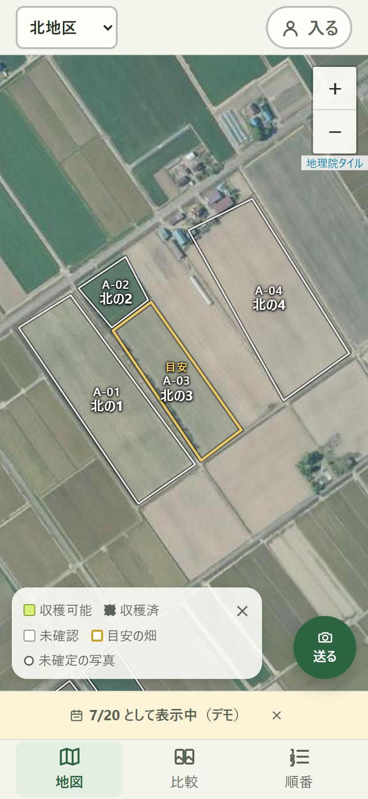

# ear-to-ear — 穂から穂へ、写真と判断をつなぐ

> ear ＝ 麦の穂。ear to ear ＝ 満面の笑み／穂から穂へ、委員から委員へ。

<p align="center">
  <!-- TODO(提出時): href を動画の URL に -->
  <a href="#"></a><br>
  <sub>地図の画面（手元で動かしたもの）。空中写真は地理院タイル、区画の番号・名前は架空</sub>
</p>

<p align="center">
  <b>▶ デモ動画（3 分）</b>: <!-- TODO(提出時): 動画の URL --> ／
  <b>デモのサイト</b>: <!-- TODO(提出時): demo の URL --> （ログイン不要。見るだけ）
</p>

**小麦の収穫委員のための、写真と判断の共有サイト。** 委員が写真を選んで送るだけで、どの畑かの候補と撮影日が付き、ほかの委員の画面にすぐ届きます。畑の番号が決まらなくても「未確定」として先に共有し、管理者が確定・訂正します。「刈れるか」の判断と理由も同じ地図に残り、Claude が引用（Citations）で根拠つきの引き継ぎメモを書きます。

Built with Claude: Japan 2026（2026-11-02 〜 11-08）の期間中に、ゼロから作りました。

## 誰の、どの作業を変えるか
北海道更別村では、小麦を地区ごとに共同で収穫します。刈る順番を決めるために、委員はドローンで畑を上から撮り、LINE で送り合います。でも**畑の番号と写真が別々に流れ、どの写真がどの畑か分かりません**（委員長の言葉: 「時間より、見づらい」）。いまは一人が写真を受け取って番号を付けて載せているので、その人の作業を待たないと共有されません。そして、その年に何を見て「刈れる」と決めたかは、次の年の委員には残りません。

## できること
| 場面 | 画面 | 中身 |
|---|---|---|
| 送る | `/upload` | 写真を選ぶと、撮影位置から畑の番号の候補（3 つまで）と撮影日が付く。**撮影位置は端末の中で使い終えたら捨て**、画像のメタデータは全部消してから送る |
| LINE から送る | — | 委員の LINE グループに送った写真も、サーバーが受け取って新着に「未確定」で入れる。いつもの LINE で送るだけでよい |
| 届く・確定する | `/recent` | 別の委員の画面に「未確定（推定 A-06）」で届く。管理者が番号を確定・訂正し、誰がいつ直したかが履歴に残る |
| 地図 | `/` | 空中写真の上に畑の区画。判断の色と印（収穫可能・収穫済）、地区の目安の畑、刈る順番の丸 |
| 見比べる・判断を残す | `/fields/[id]` | 同じ日に撮った別の畑と、この畑の前の日と、昨年の同じ頃と見比べる。判断（収穫可能／収穫済）に理由（穂の色・黄色い穂の割合・農協の判定で中止）と根拠の写真を付けて残す。記録する前に、LINE に届く内容を確かめられる。取り消しても記録は消えない |
| 刈る順番 | `/order` | 記録から下書きを作り、委員長が並べ替えて確定する。確定した順を地図 1 枚の絵にして共有の URL を作り、LINE に貼るとサムネイルで届く |
| 引き継ぎメモ | `/fields/[id]` | 1 年分の写真と判断から、Claude が次の年の委員へのメモを書く。**一文ごとに元の記録を指し**、印を押すとその記録に戻れる。根拠の無い文は灰色の「根拠なし」で分けて見せる |
| 昨年の引き継ぎ | `/`・`/fields/[id]` | 昨年の判断の頃だけ、昨年のメモを出す（デモは手で書いた架空の例。URL の末尾に `?today=2026-07-20` を付けると出る） |
| LINE のお知らせ | — | 判断を残した・取り消したときに、委員の LINE グループにサムネイル付きで 1 通。失敗しても記録は成功する |

## Claude の使い方
詳しくは [docs/claude-usage.md](docs/claude-usage.md)（すべて PR・Issue・記録へのリンクつき）。

**作品の中の Claude**
- 引き継ぎメモは Claude API の引用機能で書く。記録 1 件を 1 つの要素として渡し、返事の引用から元の記録に戻す。渡した記録の外を指す引用は捨て、記録に無いことは書かせない
- dev で本物の Claude を通した（2.3 秒、根拠つき 1/2。根拠の無い 1 文は「根拠なし」で表示）

**作るときの Claude**
- **人はテストだけを書き、実装は人のいない Claude が書く**。組み込みの道具をすべて外し、自作の MCP の道具だけを渡した「檻」の中で、1 本ずつリレーで回した。11 月 4 日の 1 日で、サーバーの 10 本をこの形で通した（9 本の費用は API 換算で合計 $5.09）
- **テストを固める前に、別の Claude に「ズルで通して」と頼む**（攻撃役、Sonnet で 1 回 $0.07〜0.27）。見つかった抜け道（例: 記録を読まず決まった 3 件を返す、先頭の 1 行だけ検査する）を塞いでから凍結した
- **書いた会話を見ていない別のセッションがレビューする**。デプロイの設計では「止める」を 2 回出し、2 回とも設計を変えた。別の会社のモデル（Codex）の点検も使う
- モデルは役で分けた: Fable は発想、Opus は設計・テスト・レビュー・無人の実装、Sonnet は攻撃役

## 開発体制
| メンバー | 主な担当 |
|---|---|
| Ryokou Tanaka（[@akutodazo](https://github.com/akutodazo)） | 企画と委員長（父）への聞き取り、仕様と合格条件、写真を送る・新着・畑の画面、判断と引き継ぎメモの画面側、画面の再設計（地図・見比べる・刈る順番・来年の引き継ぎ）、安全検査、Android の実機での確認 |
| Satoru Takahashi（[@satorutkhs](https://github.com/satorutkhs)） | 無人で実装させる仕組み（MCP の檻・檻リレー・攻撃役の手順）、サーバーの API、引き継ぎメモのサーバー側（Claude API）、デプロイ（GitHub Actions・Cloudflare）、LINE（お知らせ・写真の受け取り・共有の URL）、iPhone の Safari での確認、画面の作り直し |

どちらも、コードは Claude に書かせ、人はテスト・仕様・レビュー・実機の確認を受け持ちました。

## 安全とプライバシー
- **撮影位置（座標）は端末の外に出さない**。サーバーに届くのは候補の番号だけで、D1・R2・通信のどこにも座標は無い（[docs/privacy.md](docs/privacy.md)）
- 送る画像は端末で作り直し、位置・日時などのメタデータ（APP1〜15）を全部消す。サーバーでも無いことを確かめてから保存する。LINE から受け取った写真も、サーバーで画像の中身だけを残してから保存する
- 公開リポジトリには実写真・実在の畑の座標・合言葉・API キーを入れない。`npm run check:safety` を毎回の CI で流し、提出前に全履歴も検査した
- 地図の区画の番号・名前・判断の記録・刈る順番は架空。区画の形は、作者の家とは無関係の公開の農地の空中写真に写る畑の境目からなぞった
- デモのサイトと動画に出る畑の写真は、作者の家族が撮った本物の写真。アプリの「送る」から入れたので、位置と日時のメタデータは消えている。番号は架空の区画に付け直した。リポジトリには入れていない

## 手元で動かす
動作環境: Node.js 24（CI と同じ版）。画面はスマホのブラウザ（Android の Chrome・iPhone の Safari）と PC のブラウザで使う。

```bash
npm ci
npm run check   # 安全検査 → lint → 型 → テスト → build
```

画面と API（Cloudflare Workers・D1・R2）を手元で動かす（ログイン不要）:
1. `.dev.vars`（Git に入らない）を作り、`MEMBER_PASSPHRASE`（委員の合言葉）・`ADMIN_PASSPHRASE`（委員長の合言葉）・`SESSION_SECRET`（Cookie の署名の鍵）を `名前=値` の形で書く（手元の試し用の値。2 つの合言葉は別の値にする）。Claude と LINE は任意で、無ければ使わない（`CLAUDE_API_KEY`・`LINE_CHANNEL_ACCESS_TOKEN`・`LINE_CHANNEL_SECRET`）。名前の一覧は [worker/env.ts](worker/env.ts)
2. `npm run build`
3. `npx wrangler d1 migrations apply DB --local`
4. `npx wrangler dev` → `http://localhost:8787`

Claude と LINE を手元で使うときの設定は [docs/dev/l6-live.md](docs/dev/l6-live.md)・[docs/dev/line.md](docs/dev/line.md)。

## 技術
| 部分 | 使ったもの |
|---|---|
| 画面 | Next.js（App Router、静的書き出し）、TypeScript、Leaflet、地理院タイル（空中写真） |
| サーバー | Cloudflare Workers、D1（記録）、R2（写真） |
| AI | Claude API（モデル `claude-sonnet-5-5`、引用機能。SDK を使わず fetch で呼ぶ） |
| 通知 | LINE Messaging API |
| テストと CI | Vitest、GitHub Actions（main へのマージで dev にデプロイ） |

## 確かめたこと
合格条件と、それぞれをどう確かめたかは [docs/spec.md](docs/spec.md) の §9、実機の記録は [docs/verification/](docs/verification/)。
- **済**: 二端末（Android と PC）で、一方が送った写真が他方の新着に未確定で届き、確定が両方に見える。送る中身に撮影位置が無い
- **dev で動いた**: 本物の Claude での引き継ぎメモ。iPhone の Safari と LINE で、刈る順番の共有の URL のサムネイル。iOS シミュレータの Safari で、送る・新着・確定・番号の付け替え
- **未実施**: 委員長（父）の試用。実写真の撮影位置での候補の当たり方。iPhone の実機での送る・確定

## 制約（いま分かっていること）
- 小麦の水分は推定しない。水分は収穫後に農協でトラックの荷ごとに測られ、その判定は「判断の理由」として残す
- 画像の見比べは判断の補助で、自動で「刈れる」とは言わない
- **Android の Chrome は、スマホのカメラで撮った写真の撮影位置を消して渡す**。この場合は候補が出ず、「未確定」で送って管理者が番号を確定する
- 刈る順番の並べ替えは、いまは端末の中だけに保存する（共有は、確定した順の絵を LINE に送る形）

## ライセンス
[MIT License](LICENSE)

## 文書
仕様: [docs/spec.md](docs/spec.md)／決定: [docs/decisions.md](docs/decisions.md)／公開範囲: [docs/privacy.md](docs/privacy.md)／予定表: [docs/schedule.md](docs/schedule.md)／Claude の使い方: [docs/claude-usage.md](docs/claude-usage.md)
